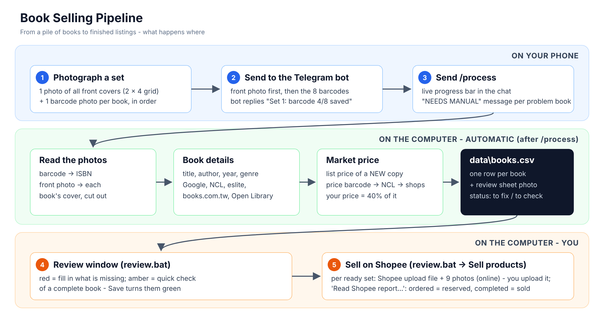

# Book Selling Pipeline

Photograph a set of books, send the photos to a Telegram bot, and get every book's ISBN, title, author and the price of
a new copy - with your selling price worked out for you. You fix anything missing in a simple review window, then sell
on Shopee from the same window: one click makes Shopee's bulk-upload file (and puts the photos online) for every
finished product, and another reads Shopee's order report back to mark products sold.



## Guides

| Read | When |
|---|---|
| **[SETUP.md](SETUP.md)** | once, first: install, data folders, Telegram bot, keys, first set, Shopee, photo links (~40 minutes) |
| [TELEGRAM_SETUP.md](TELEGRAM_SETUP.md) | step 3 of the setup: your own Telegram bot (~5 minutes) |
| **[DAILY_USE.md](DAILY_USE.md)** | every day: send → process → review → sell on Shopee; all commands; troubleshooting |
| [DATA_AND_STATUSES.md](DATA_AND_STATUSES.md) | what is stored where (`books.csv`, `products.csv`, `listings.csv`), condition grades, every status |

**Quick start:** double-click **`setup.bat`** (installs everything, makes `.env` and the data folders, runs the
tests) → fill in `.env` → from then on it is two double-clicks: **`bot.bat`** (receive and process photos) and
**`review.bat`** (check the books, then **Sell products**: Shopee's upload file, photos, order reports).

**Words.** A **set** is the books of one front photo (photographed together). A **product** is what you sell as one
thing - a whole set, or (if you choose it for that set) each of its books on its own - with a **product code** (a set's
is batch + set id, e.g. `20261008-153012-S01`; a book's is its sku). A **listing** is a product on one platform.

---

## How books and prices are found

**Book details** (title, author, publisher, year, pages, genre). Taiwanese ISBNs (978-957, 978-986, 978-626) are
asked, in order (`BOOK_PROVIDERS_TW`): **Google Books → NCL → eslite → books.com.tw → Open Library**; other ISBNs:
Open Library → Google Books → ISBNdb. Later sources only fill what is still empty, and the search stops once title,
author, publisher, year and genre are known. For Taiwanese books the **Chinese** title and genre are always preferred
over English ones, so a book Google only knows in English is looked up further. Every answer is remembered in
`data\cache`, so processing a book again costs nothing.

- **NCL** (國家圖書館 全國新書資訊網, Taiwan's ISBN agency) is searched by ISBN in its catalogue. When the title in the
  result is a link, the full record behind it gives the registered price (定價) and the subject heading (主題標題).
- **Genre** is stored as *overarching > most specific*, e.g. `童書 > 冒險／驚悚小說`: from NCL's subject heading,
  eslite's category levels, books.com.tw's 本書分類 / breadcrumb, or Google's category. Navigation steps that are not
  genres (首頁, 中文書, the book's own title ...) are left out.

**Market price** = the list price (定價) of a **new, printed** copy, first match wins:

1. the small **price barcode** printed next to the ISBN barcode, read from your back photo (free, instant)
2. **NCL** - the price the publisher registered (finds out-of-print books)
3. the ISBN in eslite's and books.com.tw's own search
4. a web search for the ISBN, e.g. `9789574760190 site:eslite.com` - only with a Tavily / LangSearch key
5. the title in the shops' search → the same book in **another printed edition** (same title and author, Taiwanese
   edition, never a boxed set or another volume)
6. one web search for title + author

E-books and audiobooks are never used. Step 5-6 prices are marked `similar` in the `market_match` column and in the
review window, so you can check them.

**Your price** = market price × `PRICE_RATIO` (40%) in the **same currency** - 300 TWD → 120 TWD. A price you type or
caption is never changed automatically.

---

## Updating to a new version

Your `.env`, `data` and `.venv` are never part of an update. With the project in Git:

1. `git status` - commit or undo your own changes first.
2. Delete everything except `.git`, `.env`, `data` and `.venv`:
   `Get-ChildItem -Force | Where-Object { '.git','.env','data','.venv' -notcontains $_.Name } | Remove-Item -Recurse -Force`
3. Copy the **contents** of the new `Book Selling Pipeline` folder from the zip into your folder.
4. `git add -A`, `git status` (check the list), `git commit -m "Update"`, `git push`.
5. Double-click **`setup.bat`**: it installs anything new, brings older data files up to date and runs the tests
   (your `.env` is left as it is). Then `git diff HEAD~1 -- .env.example` shows new or changed settings worth
   copying into your `.env`.

`books.csv` from an older version is converted the first time it is saved (e.g. the column `source` became
`book_source`, `barcode_photo` became `back_photo`; `barcode_addon`, `trademe_id`, `ebay_id` and `fb_status` are gone - selling is tracked in `products.csv`
and `listings.csv`). Books you had marked `listed` / `sold` yourself keep that: their product starts as listed / sold. After an update that cuts covers better, `python -m pipeline covers --redo`
cuts the covers of books not yet listed again. `python -m pipeline covers` (no `--redo`) makes the front + back pictures
of books processed before they existed.

Settings that no longer exist are simply ignored (`SET_SPLIT`, `BACK_ROTATE`, `PHOTO_ORDER`, `GOOGLE_COUNTRY`,
`BRAVE_API_KEY`, `MARKET_EBOOK`). If your `.env` was made from an older version, check these - your old values
override the new defaults:

- `BOOK_PROVIDERS_TW=google,ncl,eslite,books_tw,openlibrary`
- `LOOKUP_STOP_WHEN=title,author,publisher,year,genre`
- `MARKET_PROVIDERS=barcode,ncl,eslite,books_tw`
- `SET_DISCOUNT=20%` (older `.env` files say 0) and `SHOPEE_CATEGORY_NAME=其他書籍` (older ones say 二手書, which
  Shopee doesn't have)
- `SET_WEIGHT_PER_BOOK_G` is gone (no weight is sent to Shopee any more) - delete the line. A product an older
  version put in a plain sheet (made without the template) goes back to **ready** and into the next upload file by
  itself.
- `SHOPEE_TEMPLATE` should be blank now (the template lives in `data\listings\shopee\template\`, any name). New
  optional photo settings: `PHOTO_HOST`, `IMGBB_API_KEY` ([SETUP.md step 7](SETUP.md#7-photo-links-photos-online-automatically)).

**"Sets" became "products".** What you sell is now called a *product* (a set of books - later also a single book), so
the first run after this update converts, once and automatically:

- `data\sets.csv` → `data\products.csv` (`set_code` → `product_code`, `set_title` → `title`, `set_price` → `price`,
  new column `kind` = `set`); the old file is kept as `data\sets_old.csv`;
- `data\listings.csv`: `set_code` → `product_code`;
- `data\listings\shopee\template.xlsx` → `data\listings\shopee\template\template.xlsx`. New upload files go to
  `data\listings\shopee\uploads\`; older ones stay where they are.

The commands `sets` / `set-status` still work as `products` / `product-status`; the review window's button is
**Sell products** (`Ctrl+L`).

**New in this version:** a set can be sold **per book** - review window → the Whole set box → **Sell this set: Each
book on its own**; Sell products then shows one product per book (title = the book's title, its own price, 2 photos:
front and back). Only for the sets you choose; the default stays one product per set.

**Earlier:** `setup.bat` does the whole install (no more typing the commands); Sell products has
**Quantity** - in stock (庫存) and minimum purchase (最低購買數量), both 1 by default - and the automatic title is now
simply `【<code>】二手書8本一套`. Products not yet listed get the new title unless you had typed your own.

**`shopee.bat` is gone** - everything it did is in review → **Sell products**: **Make Shopee upload file** (opens the
uploads folder when done), **Read Shopee report...** for order reports, and per product **Make a new upload file for
it** (was `--redo`) and **Open its photos**.

---

## Project layout

```
Book Selling Pipeline/
├── README.md                        this overview
├── SETUP.md, TELEGRAM_SETUP.md      one-time setup
├── DAILY_USE.md                     the routine, commands, troubleshooting
├── DATA_AND_STATUSES.md             what is stored, and every status
├── .env.example → .env              settings (your copy: .env)
├── setup.bat                        double-click once (and after updates): installs, .env, data folders, tests
├── bot.bat, review.bat              double-click launchers for every day
├── requirements.txt                 what pip installs (requirements-dev.txt adds pytest)
├── docs/                            the flow diagram
├── data/                            made by `python -m pipeline setup` (or any command): inbox, processed photos,
│                                    books.csv, products.csv, listings.csv, listings (photos, Shopee template /
│                                    uploads / import), cache
├── tests/                           automated tests (python -m pytest)
└── pipeline/                        the program  (python -m pipeline ...)
    ├── __main__.py                  the commands
    ├── core/                        settings, the CSV files, web requests, checks, live progress
    ├── photos/                      barcode reading, front-photo grid, inbox, splitting into sets
    ├── sources/                     book details, market prices, web search
    └── apps/                        Telegram bot, review window, editing, products, Shopee, photo hosting
```
